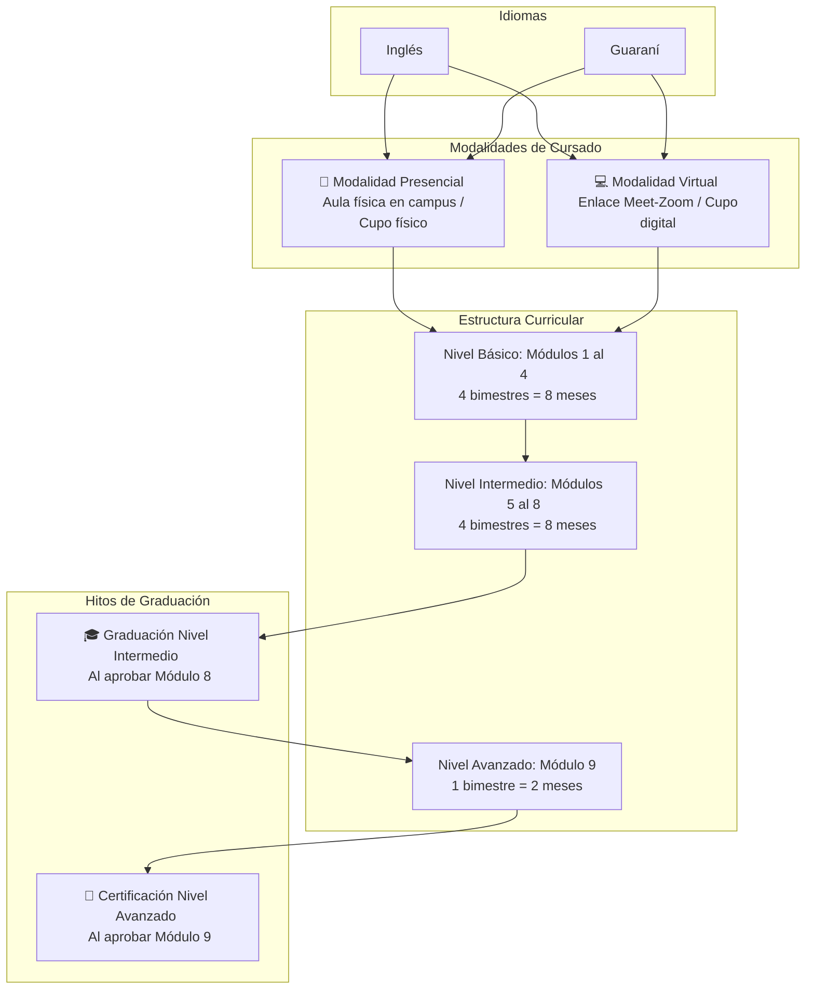
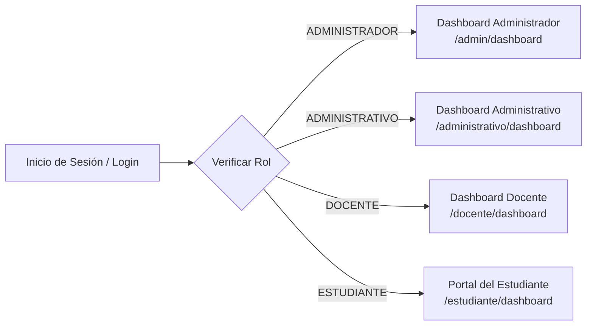
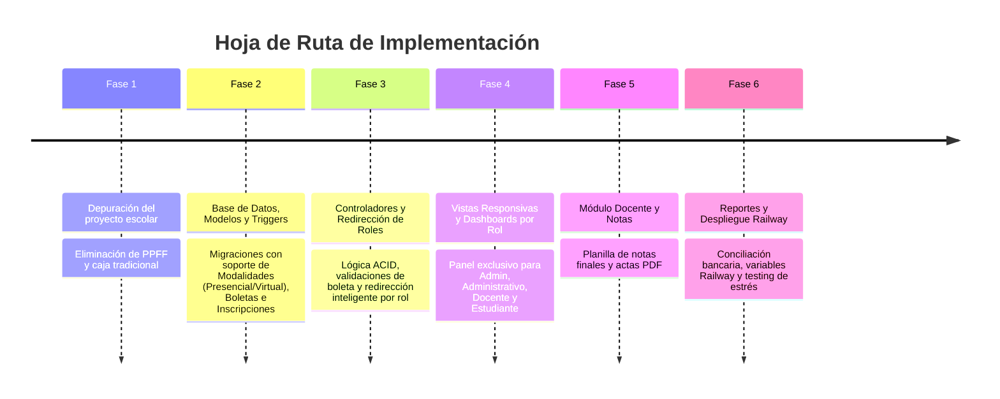

# PLAN MAESTRO DE DESARROLLO
## Sistema de Gestión Académica para Instituto Universitario de Idiomas (CEI)

---

## 1. Visión y Alcance del Sistema

El sistema es una **plataforma web integral de administración académica y control de estudiantes** desarrollada en **Laravel 12 (arquitectura MVC)** para un Instituto Universitario de Idiomas.
* **Propósito:** Automatizar la inscripción mediante validación de boletas bancarias/universitarias, control de grupos en **Modalidad Presencial y Virtual**, control de turnos y cupos, registro simplificado de notas finales por módulo, seguimiento de avance curricular (básico, intermedio y avanzado) y emisión de reportes estadísticos y actas oficiales.
* **No es un LMS:** No gestiona tareas, foros ni contenidos educativos. Se enfoca estrictamente en **gestión académica, control escolar, fiscalización de boletas y reportes**.
* **Vistas Especializadas por Rol:** Cada actor (**Administrador, Administrativo, Docente y Estudiante**) cuenta con su **propio panel/dashboard de inicio exclusivo** al autenticarse, adaptado a sus necesidades y responsabilidades.
* **Destino de Despliegue:** **Railway (Cloud PaaS)** con contenedores Docker (PHP 8.2-FPM + Nginx) y base de datos MySQL gestionada con soporte nativo de **Triggers**, alta concurrencia y diseño **100% responsivo para móviles y escritorio**.

---

## 2. Paquetes y Herramientas (Stack Tecnológico)

### Backend (PHP 8.2+ / Laravel 12)
* **`spatie/laravel-permission` (^6.24):** Control de acceso granular basado en Roles y Permisos (RBAC).
* **`barryvdh/laravel-dompdf` (^3.1):** Generación de documentos oficiales en PDF:
  * Ficha / Comprobante de inscripción del estudiante (con indicación de Modalidad: Presencial o Virtual, aula o enlace de acceso).
  * Acta de notas finales por módulo, modalidad y docente.
  * Certificado / Ficha de egreso de Nivel Intermedio (Módulo 8) y Nivel Avanzado (Módulo 9).
  * Reporte de conciliación de boletas para Tesorería Universitaria.
* **`jeroennoten/laravel-adminlte` (^3.15):** Dashboard administrativo responsivo con estética moderna y adaptable a pantallas táctiles.
* **`laravel/ui` (^4.6):** Autenticación base y scaffolding de sesiones seguras.

### Frontend & UI/UX Responsivo
* **AdminLTE 3 + Bootstrap 4:** Estructura visual coherente, cards colapsables y layout con sidebar retráctil para móviles.
* **DataTables con extensiones:**
  * `Responsive` (adaptación automática de tablas en smartphones con filas expandibles).
  * `Buttons` (exportación a Excel, PDF, Impresión).
* **SweetAlert2:** Alertas interactivas y modales de confirmación con diseño adaptable.
* **Select2:** Selectores predictivos con autocompletado y búsqueda AJAX optimizada para grandes volúmenes de datos (búsqueda combinada: Idioma + Módulo + Modalidad + Turno).

---

## 3. Modelo del Negocio Académico



### Reglas Clave del Negocio:

1. **Modalidades de Cursado (Presencial y Virtual):**
   * Cada grupo/paralelo pertenece a una **Modalidad**:
     * **Modalidad Presencial:** Asignación de aula física en el campus universitario (ej. *Aula 204 - Módulo Central*), horario presencial y control estricto de cupo físico por capacidad de aula.
     * **Modalidad Virtual:** Asignación de plataforma y enlace de sala de videoconferencia (ej. *Google Meet / Zoom / Microsoft Teams*), horario online y cupo digital administrado.
   * La matrícula/ficha de inscripción y las actas de notas reflejan explícitamente la modalidad cursada.
2. **Duración:** Cada módulo tiene una duración bimestral fija (2 meses).
3. **Prerrequisito Obligatorio:** Un estudiante sólo puede inscribirse al Módulo $N$ si aprobó el Módulo $N-1$ en el mismo idioma (o si fue homologado/ubicado por examen de suficiencia). *El estudiante puede cambiar de modalidad (ej. cursó Módulo 1 presencial y Módulo 2 virtual) siempre que el prerrequisito del módulo anterior esté aprobado.*
4. **Flujo de Pago Universitario (Cero Efectivo en Instituto):**
   * El estudiante paga directamente a la Universidad (caja central o entidad bancaria).
   * Presenta su boleta/depósito físico o comprobante digital.
   * El administrativo registra el número de boleta, fecha, monto y adjunta el comprobante (evidencia).
   * Cada boleta es **única** (no reutilizable) y es el requisito que **activa y valida la inscripción**.
5. **Calificación Simplificada:** El docente ingresa **exclusivamente la Nota Final** (escala de 1 a 100, aprobación con nota $\ge 51$ o según norma institucional).

---

## 4. Actores del Sistema y Redirección Inteligente Post-Login

Al ingresar al sistema (`/login`), el flujo de autenticación detecta automáticamente el rol del usuario mediante Spatie Permissions y lo redirige a su **vista especializada**:



### 4.1. Detalle de las Vistas de Inicio por Rol:

#### A. Vista del Administrador (`admin.dashboard`)
* **Propósito:** Control global, supervisión institucional y auditoría.
* **Componentes visuales:**
  * Métricas principales (Tarjetas Info-Box): Total estudiantes activos, Docentes en servicio, Alumnos en Presencial vs Virtual en el ciclo activo, Total de boletas conciliadas.
  * Accesos rápidos a Configuración del Instituto, Gestión de Idiomas, Módulos, Apertura de Ciclos Bimestrales y Asignación de Aulas/Enlaces.
  * Gráfico estadístico de inscritos por idioma y modalidad.
  * Registro de auditoría de modificaciones de notas (alimentado por Trigger).

#### B. Vista del Personal Administrativo (`administrativo.dashboard`)
* **Propósito:** Operatividad diaria de inscripciones, padrón y control de cupos.
* **Componentes visuales:**
  * **Accesos Rápidos Destacados (Botones de Acción Inmediata):**
    * 🎓 **Nueva Inscripción Modular**
    * 🧾 **Registrar Boleta de Pago**
    * 👥 **Búsqueda / Padrón de Estudiantes**
    * 📊 **Conciliación de Boletas para Tesorería**
  * **Monitor de Cupos en Tiempo Real:** Tabla resumida del ciclo actual con el estado de cupos disponibles vs ocupados en grupos **Presenciales** (aulas) y **Virtuales** (enlaces).
  * Alertas de boletas registradas hoy y pendientes de verificación.

#### C. Vista del Docente (`docente.dashboard`)
* **Propósito:** Gestión ágil de grupos asignados y registro de notas sin distracciones.
* **Componentes visuales:**
  * Tarjetas de los **Grupos Asignados en el Ciclo Actual**:
    * Idioma y Módulo (ej. *Inglés - Módulo 3*).
    * Modalidad y Ubicación:
      * Si es **Presencial:** Muestra el número de Aula y Turno.
      * Si es **Virtual:** Muestra el enlace a la sala de Meet/Zoom y Turno.
    * Contador de estudiantes inscritos en el grupo.
    * Botón de acción directo: **`Cargar Notas Finales`** (abre la planilla del grupo).
    * Botón: **`Descargar Lista de Asistencia / Acta en PDF`**.
  * Cero menús de configuración o inscripciones en su barra lateral.

#### D. Vista del Estudiante (`estudiante.dashboard`) - Portal del Estudiante
* **Propósito:** Experiencia de usuario limpia y adaptada a teléfonos móviles para que el estudiante siga su avance académico.
* **Componentes visuales:**
  * **Tarjeta de su Módulo Actual:**
    * Idioma, Módulo, Horario y Docente a cargo.
    * **Acceso a Clase según Modalidad:**
      * Si es **Presencial:** Pabellón y Aula física asignada.
      * Si es **Virtual:** Botón interactivo táctil **`Entrar a Clase Virtual (Meet/Zoom)`**.
    * Botón para descargar su **Ficha de Inscripción Oficial (PDF)**.
  * **Ruta de Aprendizaje y Avance Curricular (Visualizador Gráfico):**
    * Barra de progreso interactiva con check de módulos:
      * 🟡 Nivel Básico: Módulo 1, 2, 3, 4.
      * 🔵 Nivel Intermedio: Módulo 5, 6, 7, 8 $\rightarrow$ Meta: 🎓 **Graduación Intermedia**.
      * 🟣 Nivel Avanzado: Módulo 9 $\rightarrow$ 📜 **Certificación Avanzada**.
  * **Kárdex Histórico:** Tabla con las notas finales obtenidas en cada módulo aprobado.

---

## 5. Casos de Uso Detallados (CU)

### Módulo 1: Configuración Institucional y Catálogos Académicos (Admin)
* **CU-01:** Gestionar Datos del Instituto (Nombre, logos, firmas autorizadas, datos de contacto). *(Vista dedicada)*
* **CU-02:** Gestionar Idiomas (Inglés, Guaraní, etc.). *(Modal CRUD)*
* **CU-03:** Gestionar Módulos y Niveles (Módulos 1 al 9, asignación de nivel: Básico, Intermedio, Avanzado). *(Modal CRUD)*
* **CU-04:** Gestionar Gestiones y Ciclos Bimestrales (Año 2026, Bimestre I: Ene-Feb, Bimestre II: Mar-Abr, etc.). *(Modal CRUD)*
* **CU-05:** Gestionar Modalidades, Turnos y Paralelos:
  * Crear grupos con: Nombre del Paralelo (A, B, C...), **Modalidad** (`PRESENCIAL` o `VIRTUAL`), **Ubicación/Enlace** (Aula física o URL de Meet/Zoom), Turno (Mañana, Tarde, Noche) y Cupo Máximo. *(Modal CRUD)*

### Módulo 2: Gestión de Usuarios y Seguridad (Admin)
* **CU-06:** Gestionar Usuarios (Creación, edición, reseteo de clave, vinculación a perfil Docente/Administrativo/Estudiante). *(Vista dedicada)*
* **CU-07:** Matriz de Roles y Permisos (Asignación granular Spatie). *(Vista dedicada)*
* **CU-08:** Perfil de Usuario y Cambio de Contraseña. *(Modal o Vista dedicada)*

### Módulo 3: Padrón y Registro de Estudiantes (Administrativo / Admin)
* **CU-09:** Registrar nuevo Estudiante (CI, nombres, apellidos, teléfono, email, carrera/ocupación; creación automática opcional de credenciales de acceso). *(Vista dedicada)*
* **CU-10:** Listar y Buscar Estudiantes (Búsqueda en tiempo real con DataTables Server-Side). *(Vista dedicada)*
* **CU-11:** Editar/Actualizar datos de Estudiante. *(Vista dedicada)*
* **CU-12:** Visualizar Kárdex / Ficha Académica del Estudiante (Módulos cursados, aprobados, pendientes, detallando la modalidad en que cursó cada uno). *(Vista dedicada)*

### Módulo 4: Registro y Fiscalización de Boletas Universitarias (Administrativo)
* **CU-13:** Registrar Boleta de Pago Universitario (N° de boleta/transacción única, fecha de depósito, monto, banco emisor, foto/PDF de comprobante). *(Modal rápido o Vista dedicada)*
* **CU-14:** Auditoría y Verificación de Boletas (Evitar duplicidad de comprobantes bancarios). *(Control automático backend + Trigger)*
* **CU-15:** Reporte de Conciliación de Boletas para Tesorería Universitaria (Exportable a Excel y PDF). *(Vista dedicada)*

### Módulo 5: Inscripciones / Matriculaciones (Administrativo)
* **CU-16:** Realizar Inscripción Modular:
  1. Seleccionar estudiante (Select2 predictivo por CI o nombre).
  2. Seleccionar Idioma y Módulo disponible (el sistema valida automáticamente correlativas).
  3. **Seleccionar Modalidad:** Filtrar por `Presencial` (muestra aula y cupo de asientos) o `Virtual` (muestra enlace de videoconferencia y cupo digital).
  4. Seleccionar Turno y Paralelo.
  5. Asociar la Boleta de Pago registrada.
  6. Confirmar mediante transacción atómica (ACID). *(Vista dedicada)*
* **CU-17:** Imprimir Ficha de Matrícula (Comprobante oficial en PDF con DomPDF, especificando claramente la modalidad, horario, y aula física o enlace virtual de conexión). *(Generación PDF)*
* **CU-18:** Anular/Cancelar Inscripción (Reversión controlada con justificación y liberación de boleta). *(Modal con SweetAlert2)*

### Módulo 6: Asignación Académica y Control Docente (Admin / Administrativo)
* **CU-19:** Asignar Docente a Grupo (Docente + Idioma + Módulo + Modalidad [Presencial/Virtual] + Turno + Paralelo + Ciclo Bimestral). *(Modal CRUD)*
* **CU-20:** Listar Asignaciones Activas por Ciclo y Modalidad. *(Vista dedicada)*

### Módulo 7: Calificaciones y Actas (Docente / Administrativo)
* **CU-21:** Ver Mis Grupos Asignados (Panel del Docente con filtro de grupos Presenciales y Virtuales con sus alumnos). *(Vista dedicada)*
* **CU-22:** Registrar Nota Final del Módulo (Planilla en línea donde el docente coloca la nota definitiva [0 - 100]; cálculo automático de estado: Aprobado $\ge 51$ / Reprobado). *(Vista dedicada)*
* **CU-23:** Cierre de Acta de Notas (Bloqueo de edición una vez vencido el plazo del ciclo bimestral). *(Acción con confirmación SweetAlert2)*
* **CU-24:** Imprimir Acta de Notas Oficial (PDF con firma digital/espacio de firma del docente, con membrete oficial y modalidad). *(Generación PDF)*

### Módulo 8: Portal del Estudiante (Estudiante)
* **CU-25:** Consulta de Módulos Inscritos en el ciclo actual (Horario, turno, docente, **aula física o enlace virtual de clase**). *(Dashboard responsivo)*
* **CU-26:** Historial Académico y Avance de Idioma:
  * Visualizador gráfico de la ruta de aprendizaje: Módulos 1 al 4 (Básico) $\rightarrow$ Módulos 5 al 8 (Intermedio) $\rightarrow$ Módulo 9 (Avanzado).
* **CU-27:** Descarga de Fichas de Inscripción y Certificado de Aprobación Intermedia (al culminar módulo 8). *(Descarga PDF)*

### Módulo 9: Reportes, Recuentos y Estadísticas (Admin / Administrativo)
* **CU-28:** Reporte de Inscritos por Idioma, Módulo, **Modalidad (Presencial vs Virtual)** y Turno. *(Filtros interactivos + exportación Excel/PDF)*
* **CU-29:** Reporte de Estudiantes Aptos para Graduación Intermedia (Estudiantes con módulos 1 al 8 aprobados). *(Vista dedicada + PDF)*
* **CU-30:** Reporte de Rendimiento y Deserción comparativo entre Modalidad Presencial y Virtual. *(Gráficos estadísticos y tablas)*

---

## 6. Estrategia de Vistas y Experiencia de Usuario (UX) Responsiva

```
┌─────────────────────────────────────────────────────────────┐
│ ESTRATEGIA DE VISTAS (100% RESPONSIVE)                      │
├──────────────────────────────┬──────────────────────────────┤
│ 🟢 MODALES (Operaciones Ágiles)│ 🔵 VISTAS COMPLETAS (Flujos) │
├──────────────────────────────┼──────────────────────────────┤
│ • Idiomas (Crear / Editar)   │ • Dashboards por cada Rol    │
│ • Módulos y Niveles          │ • Inscripción paso a paso    │
│ • Modalidades y Paralelos    │ • Padrón de Estudiantes      │
│ • Turnos y Aulas / Enlaces   │ • Ficha / Kárdex del Alumno  │
│ • Ciclos Bimestrales         │ • Carga masiva de Notas      │
│ • Registro rápido de Boleta  │ • Reportes y Conciliaciones  │
│ • Asignación rápida docente  │ • Gestión de Usuarios y Roles│
└──────────────────────────────┴──────────────────────────────┘
```

### Directrices de Adaptabilidad Móvil (Smartphones & Tablets):
1. **Viewport Optimizado:** Configuración `<meta name="viewport" content="width=device-width, initial-scale=1, shrink-to-fit=no">`.
2. **Tablas con DataTables Responsive:** En pantallas pequeñas (`< 768px`), las columnas secundarias se contraen en un botón `+` expandible para evitar scroll horizontal molesto.
3. **Modales Adaptables:** Uso de clases `modal-dialog-scrollable modal-dialog-centered modal-lg` para que los formularios en modales se visualicen cómodamente en celulares.
4. **Formularios en Grid Fluido:** Uso de `col-12 col-md-6 col-lg-4` para que los campos se apilen limpiamente en dispositivos móviles.
5. **Acceso Rápido a Enlaces Virtuales en Celular:** Los estudiantes inscritos en modalidad virtual contarán con un botón directo `Entrar a Clase Virtual` optimizado para abrir Meet o Zoom en su dispositivo.

---

## 7. Mega Optimización de Rendimiento y Alto Tráfico en Railway

Para garantizar respuestas ultrarrápidas ($< 150\text{ ms}$) bajo alta concurrencia de estudiantes y docentes en periodos de inscripción y cierre de notas:

### A. Prevención de Consultas N+1 (Eager Loading Estricto)
* Todos los controladores utilizarán carga anticipada explícita:
  ```php
  // Ejemplo: Cero consultas N+1
  $inscripciones = Inscripcion::with([
      'estudiante.usuario',
      'modulo.idioma',
      'paralelo.turno',
      'boletaPago'
  ])->paginate(20);
  ```

### B. Indexación de Base de Datos para Búsquedas Instantáneas
* Se crearán índices en migraciones en todas las columnas de búsqueda y filtrado:
  * Índices únicos: `boletas_pago.numero_boleta`, `estudiantes.ci`, `users.email`.
  * Índices compuestos: `index(['idioma_id', 'modulo_id', 'ciclo_id'])`, `index(['modalidad', 'estado'])`, `index(['estudiante_id', 'modulo_id'])`.
  * Claves foráneas indexadas con `cascadeOnDelete()` o `restrictOnDelete()`.

### C. DataTables Server-Side Processing
* En listados con cientos o miles de registros (como estudiantes o boletas), los datos **no se enviarán todos de golpe al navegador**. Se consumirá un endpoint paginado en el servidor con AJAX, procesando solo 10 a 50 filas por petición.

### D. Caché de Capas en Producción (Railway)
* En el despliegue Dockerfile se ejecutan automáticamente:
  * `php artisan config:cache` (cacheo de configuración).
  * `php artisan route:cache` (compilación instantánea del árbol de rutas).
  * `php artisan view:cache` (precompilación de vistas Blade).
* **Caché en Memoria para Catálogos Estáticos:**
  ```php
  $idiomas = Cache::remember('catalogo_idiomas', 3600 * 24, fn() => Idioma::all());
  $turnos = Cache::remember('catalogo_turnos', 3600 * 24, fn() => Turno::all());
  ```

---

## 8. Blindaje de Seguridad y Prevención de Inyecciones SQL

### A. Prevención Total contra Inyecciones SQL (SQLi)
* **Uso exclusivo de Eloquent ORM y Query Builder con Prepared Statements:**
  * Queda terminantemente prohibido concatenar variables en sentencias `DB::raw(...)`, `whereRaw(...)` u `orderByRaw(...)`. Si se requiere una consulta cruda, se usarán obligatoriamente bindings:
    ```php
    // CORRECTO: Protegido contra SQLi
    DB::select("SELECT * FROM inscripciones WHERE ciclo_id = ? AND modalidad = ? AND estado = ?", [$cicloId, 'VIRTUAL', 'ACTIVA']);
    ```
* **Casting Estricto de Tipos:** Conversión y validación de enteros y enums (`(int) $id`, validación `in:PRESENCIAL,VIRTUAL`).

### B. Validaciones Backend con FormRequests Dedicados
* Sanitización automática (`trim`, `strip_tags` para evitar inyección de scripts).
* Reglas estrictas para número de boleta, formato de URL de aula virtual, fechas y notas.

### C. Protección XSS y CSRF
* En Blade se utilizará siempre la directiva de escape automático: `{{ $dato }}`.
* Tokens `@csrf` obligatorios en todos los formularios y cabecera `X-CSRF-TOKEN` en llamadas AJAX.
* **Rate Limiting:** Límites de peticiones por minuto en login y búsquedas de estudiantes para evitar ataques de fuerza bruta o saturación del servidor.

---

## 9. Triggers de Base de Datos en MySQL (Compatibles con Railway)

> **¿Railway acepta Triggers en MySQL?**
> **SÍ, 100% COMPATIBLE.** Railway aprovisiona instancias estándar de MySQL con el usuario `root` que posee permisos plenos (`SUPER` y `TRIGGER`). Los triggers se crean directamente a través de migraciones de Laravel usando `DB::unprepared(...)`.

### Triggers Implementados en el Sistema:

#### Trigger 1: Auditoría Inmutable de Modificación de Notas (`after_calificaciones_update`)
Garantiza que cualquier cambio en una nota final quede registrado a nivel motor de base de datos con la nota anterior, la nueva, el usuario responsable y la fecha exacta:
```sql
CREATE TRIGGER tr_auditoria_notas_after_update
AFTER UPDATE ON calificaciones
FOR EACH ROW
BEGIN
    IF OLD.nota_final <> NEW.nota_final THEN
        INSERT INTO auditoria_calificaciones (
            calificacion_id,
            inscripcion_id,
            nota_anterior,
            nota_nueva,
            modificado_por,
            created_at
        ) VALUES (
            OLD.id,
            OLD.inscripcion_id,
            OLD.nota_final,
            NEW.nota_final,
            NEW.updated_by,
            NOW()
        );
    END IF;
END;
```

#### Trigger 2: Control Atómico de Cupos en Paralelo (`after_inscripcion_insert_cupo`)
Actualiza automáticamente el contador de inscritos del grupo (presencial o virtual):
```sql
CREATE TRIGGER tr_actualizar_cupo_after_insert
AFTER INSERT ON inscripciones
FOR EACH ROW
BEGIN
    IF NEW.estado = 'ACTIVA' THEN
        UPDATE paralelos 
        SET cupo_ocupado = cupo_ocupado + 1 
        WHERE id = NEW.paralelo_id;
    END IF;
END;
```

#### Trigger 3: Bloqueo de Reutilización de Boletas (`before_inscripcion_validar_boleta`)
Asegura a nivel motor que una boleta marcada como `UTILIZADA` no pueda asociarse a otra inscripción diferente:
```sql
CREATE TRIGGER tr_validar_boleta_before_insert
BEFORE INSERT ON inscripciones
FOR EACH ROW
BEGIN
    DECLARE estado_boleta VARCHAR(20);
    SELECT estado INTO estado_boleta FROM boletas_pago WHERE id = NEW.boleta_pago_id;
    IF estado_boleta = 'UTILIZADA' THEN
        SIGNAL SQLSTATE '45000' 
        SET MESSAGE_TEXT = 'Error de Integridad: La boleta bancaria ya fue utilizada en otra inscripción.';
    END IF;
END;
```

---

## 10. Garantías ACID y Transacciones

Todas las operaciones complejas se envolverán en `DB::transaction(...)`:
```php
DB::transaction(function () use ($datos) {
    // 1. Validar y bloquear fila de boleta (SELECT FOR UPDATE)
    $boleta = BoletaPago::where('id', $datos['boleta_id'])->lockForUpdate()->firstOrFail();
    
    // 2. Crear inscripción (asociada al paralelo presencial o virtual)
    $inscripcion = Inscripcion::create([...]);
    
    // 3. Marcar boleta como utilizada
    $boleta->update(['estado' => 'UTILIZADA']);
    
    // 4. Crear registro base de calificación
    Calificacion::create([
        'inscripcion_id' => $inscripcion->id,
        'nota_final' => 0,
        'estado' => 'PENDIENTE'
    ]);
});
```

---

## 11. Plan de Ejecución Paso a Paso



### Fase 1: Limpieza y Adaptación Inicial
1. Respaldar y depurar rutas y vistas escolares obsoletas (`ppffs`, cobranza de caja escolar).
2. Corregir bugs detectados en `UserController` y `RoleController`.

### Fase 2: Esquema de Base de Datos, Modelos y Triggers
1. Crear migraciones con índices optimizados: `idiomas`, `modulos`, `ciclos_bimestrales`, `turnos`, `paralelos` (con campos `modalidad` [`PRESENCIAL`, `VIRTUAL`] y `aula_o_enlace`), `boletas_pago`, `inscripciones`, `calificaciones`, `auditoria_calificaciones`.
2. Crear migración para Triggers (`tr_auditoria_notas_after_update`, `tr_actualizar_cupo_after_insert`, `tr_validar_boleta_before_insert`).
3. Definir relaciones Eloquent en los modelos con tipado y casting adecuado.
4. Crear `RoleSeeder` adaptado a los 4 roles del Instituto.

### Fase 3: Lógica de Inscripciones, Boletas y Redirección Inteligente
1. Implementar `DashboardController` con redirección post-login y renderizado de vista especializada por rol (`admin.dashboard`, `administrativo.dashboard`, `docente.dashboard`, `estudiante.dashboard`).
2. Implementar `BoletaPagoController` con validación de duplicidad y almacenamiento de comprobante.
3. Implementar `InscripcionController` con algoritmo de verificación de correlatividad y asignación de cupo (presencial con aula / virtual con link) bajo `DB::transaction`.

### Fase 4: Vistas Responsivas y Dashboards por Rol
1. Vistas con Modals para Catálogos rápidos (Idiomas, Módulos, Turnos, Paralelos por Modalidad).
2. Crear los 4 Dashboards especializados (Admin, Administrativo, Docente y Portal del Estudiante con barra de avance modular).
3. Vista completa para Ficha de Inscripción con selector dinámico Select2 (filtrando por modalidad) y DataTables Responsive.
4. Generador de Comprobante de Matrícula en PDF (DomPDF) indicando modalidad y aula/enlace.

### Fase 5: Calificación Simplificada (Docente)
1. Panel del Docente para ver sus grupos asignados (presenciales y virtuales, adaptable a celular).
2. Planilla interactiva de carga de **Nota Final** por estudiante con validación [0 - 100].
3. Generación de Acta Oficial de Notas en PDF.

### Fase 6: Reportes de Auditoría, Portal del Estudiante y Despliegue en Railway
1. Reporte de conciliación de boletas para Tesorería Universitaria (Excel / PDF).
2. Reporte de alumnos inscritos y aprobados desglosado por modalidad (Presencial vs Virtual).
3. Reporte de graduados a nivel Intermedio y Avanzado.
4. Pruebas integrales de flujo completo y verificación de despliegue en Railway.
